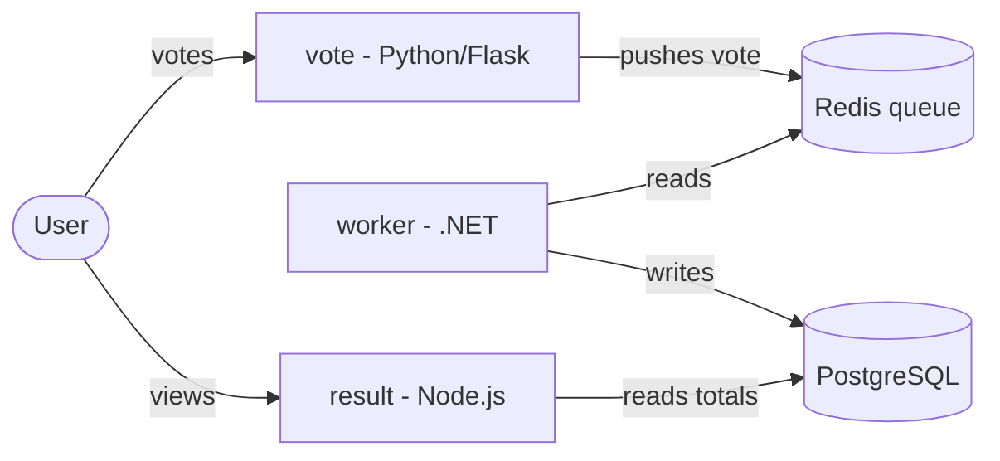

# Capstone 1: Ship It - Voting App

A distributed voting application taken from local Docker Compose to a
Kubernetes deployment, with infrastructure as code, an automated CI pipeline,
and Helm-based releases with rollback.

## Architecture



Data flow: a user casts a vote in **vote**, the vote is queued in **Redis**,
the **worker** reads the queue and writes the vote to **PostgreSQL**, and
**result** reads the running totals from PostgreSQL.

## Repository layout

| Path | Purpose |
|------|---------|
| `vote/`, `result/`, `worker/` | Application services (each hardened: pinned base image, non-root user, `.dockerignore`) |
| `docker-compose.yml` | Local development stack (hot reload) |
| `docker-compose.prod.yml` | Production-style stack using the hardened `final` images |
| `terraform/` | EKS cluster in the default VPC (Step 3) |
| `helm/voting-app/` | Helm chart for the full app (Step 5) |
| `.github/workflows/ci.yml` | Build, Trivy scan, and push images tagged with the commit SHA (Step 4) |

## Step 1 - Run locally

```bash
docker compose up -d --build
# vote:   http://localhost:8080
# result: http://localhost:8081
docker compose down
```

## Step 2 - Containerize safely

Each service image:

- pins its base image to a specific version,
- runs as a non-root user (`appuser`, uid 10001),
- ships a `.dockerignore` to keep the build context clean.

Verify the hardened production images build, start, and run as non-root:

```bash
docker compose -f docker-compose.prod.yml up -d --build
docker compose -f docker-compose.prod.yml exec vote id -un   # -> appuser
docker compose -f docker-compose.prod.yml down
```

## Step 3 - Kubernetes cluster with Terraform

Creates an EKS cluster in the account's default VPC.

```bash
export AWS_PROFILE=capstone          # use the capstone AWS account
cd terraform
terraform init
terraform apply                      # ~15-20 min; creates billable resources
# point kubectl at the new cluster (see the configure_kubectl output):
aws eks update-kubeconfig --region us-east-1 --name voting-app --profile capstone
# when finished / to stop billing:
terraform destroy
```

The environment rebuilds from code: `terraform destroy` then `terraform apply`
recreates the whole cluster.

## Step 4 - CI with GitHub Actions

On every push, `.github/workflows/ci.yml`:

1. builds each service image,
2. scans it with Trivy (HIGH/CRITICAL),
3. logs in to GitHub Container Registry and pushes the image tagged with the
   commit SHA.

No secrets are stored in the repo; the workflow uses the built-in
`GITHUB_TOKEN`.

## Step 5 - Deploy and roll back with Helm

```bash
# deploy a known-good release (use a real pushed SHA tag)
helm install voting ./helm/voting-app --set image.tag=<good-sha>

# ship a bad release on purpose
helm upgrade voting ./helm/voting-app --set image.tag=<bad-sha>

# observe failure, then roll back to the previous revision
helm rollback voting
helm history voting
```

## Security / hygiene

- No secrets committed (Terraform state and `*.tfvars` are git-ignored).
- Images run as non-root with pinned bases.
- Container images are tagged by commit SHA for traceability.

## Assumptions

- AWS is the cloud target, region `us-east-1`, using the `capstone` CLI profile.
- Images are published to GitHub Container Registry (`ghcr.io`).
- The cluster uses the default VPC as specified by the project brief.
